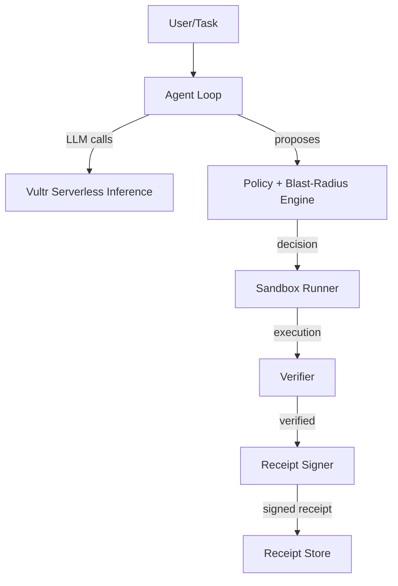

# Airlock

Verified execution firewall for AI agents.

## What it is

I built Airlock because I don't want an agent's mistake to become my incident. The model only *proposes* actions. An independent, deterministic policy engine decides whether to allow, deny, or require approval. Allowed code runs in a disposable hardened Docker container, then a verifier checks the result and cleanup, and a signed receipt is produced that anyone can verify offline.

## What is actually enforced

- **Fail-closed policy**: Default deny. Actions are allowed only when explicitly recognized as safe.
- **Language allowlist**: Only `python`, `bash`, `sh` accepted.
- **Python**: Parsed with `ast`. Imports must come from an allow-list of standard-library modules (for example `re`, `json`, `csv`, `collections`, `datetime`, `statistics`, `pathlib`, `gzip`, `hashlib`, `ipaddress`); unknown modules are denied. `os` is limited to `os.path`, `os.listdir`, `os.sep` and `os.linesep`, and `sys` to an attribute allow-list. `eval`, `exec`, `compile` (except `re.compile`), `__import__`, `_`-prefixed and introspection attributes, the `getattr` family with non-literal names, `operator.attrgetter`/`methodcaller`/`itemgetter`, module aliasing and attribute lookups in format strings are denied. File paths must be literals inside `/work/input` (read) or `/work/out` (read/write).
- **Shell**: Parsed with a shell lexer. Only allow-listed binaries with allow-listed options run (`cat`, `grep`/`egrep`/`fgrep`/`zgrep`, `awk`, `sed`, `jq`, `sort`, `uniq`, `wc`, `head`, `tail`, `cut`, `ls`, `zcat`, `gzip`/`gunzip` to stdout, `tee`, `date`, plus `echo`, `printf`, `tr`, `test`). sed and awk are not trusted as read-only: sed scripts must parse into a fixed subset without `e`, `w`, `r` or branches, and awk `getline`, `system`, redirects and `ENVIRON` are denied. File arguments may only name relative paths, `/work`, `/work/input`, `/work/out` or `/dev/null`; output goes only to `/work/out` and never to script files. Other interpreters (`python3`, `perl`, `ruby`, ...), forbidden binaries (`docker`, `mount`, `sudo`, `curl`, `wget`, `ssh`, `nc`, ...), loops, process substitution, variable expansions, command substitution and assignment-prefixed commands are denied. This is checked against a test corpus only; the sandbox is the second line of defence (see docs/KNOWN_LIMITATIONS.md).
- **Network**: Only `--network none` is supported. Egress allowlist mode is NOT implemented and raises an error if requested.
- **Sandbox hardening**: Read-only rootfs, tmpfs /work (plus small noexec tmpfs /tmp and /dev/shm), job runs as uid 65534, no capabilities for the job, no-new-privileges, pids/mem/cpu limits, wall-clock timeout watchdog with `docker kill`. The job's report is bound to a per-run nonce and parsed strictly. `files_in` reads only from a configured inputs directory.
- **Verifier**: Post-execution cleanup checks (container removed, no dangling networks), secret pattern scan, artifact hash validation.
- **Receipts**: RFC 8785 JCS canonical JSON, Ed25519 signatures, hash chain linking, optional signed chain head. Verification rejects duplicate keys, type coercion, missing fields and non-canonical hex (exit codes in `airlock/cli.py`).

## Architecture



1. **Agent Loop** uses Vultr Serverless Inference (OpenAI-compatible API) to generate actions
2. **Policy Engine** evaluates actions against YAML rules with static code analysis
3. **Blast-Radius Estimator** scores potential impact (0-100)
4. **Sandbox Runner** executes approved code in isolated Docker containers
5. **Verifier** checks post-execution state and scans for secrets
6. **Receipt Signer** produces Ed25519-signed receipts with hash chaining

## Vultr Services Used

- **Vultr Serverless Inference**: All agent LLM calls go through `https://api.vultrinference.com/v1` (OpenAI-compatible endpoint). Default model: `qwen3.8-27b`
- **Vultr Cloud Compute VM**: Ubuntu instance running Docker for sandbox execution and the control plane

## Threat Model

| Threat | Mitigation | Residual Risk |
|--------|-----------|---------------|
| Secret exfiltration | API key never enters sandbox; environment scrubbed; `--network none` default; output secret scan | Model could leak user-provided data (out of scope) |
| Destructive commands | Read-only rootfs + tmpfs; no host mounts; policy denies dangerous patterns | Damage stays inside disposable container |
| Resource exhaustion | Timeout watchdog, pids/mem/cpu caps, output size limits | Host-level DoS via many tasks needs rate limiting |
| Container escape | Non-root user, no capabilities, no-new-privileges, seccomp, gVisor where available | **Not eliminated** - Docker shares kernel |
| Policy bypass via obfuscation | AST analysis flags eval/exec/base64; containment is the real boundary | Static analysis incomplete by design |
| LLM self-approval | Decisions come from deterministic code only; LLM output is data | None |
| Receipt forgery | Ed25519 signatures + hash chain | Compromised host can sign lies |

## Honest Limits

I built this for the Vultr Agent Rush hackathon. Be aware:

- **Container isolation reduces risk but doesn't eliminate it.** Docker shares the kernel with the host. A kernel exploit could escape the sandbox.
- **Static policy can be evaded.** The sandbox is the real boundary, not the code analyzer.
- **Receipts are only as trustworthy as the host that signs them.** If the host is compromised, receipts can be forged.
- **This is not tested by a professional red team.** Use at your own risk.

Receipts prove that Airlock observed and recorded what happened. They do not prove the host wasn't compromised.

## Installation

Requires Python 3.12+ and Docker.

```bash
pip install -e ".[dev]"
```

## Usage

### Verify a receipt

```bash
airlock verify receipt.json --pubkey public.pem
```

### Run the agent

```python
from airlock.agent import AgentLoop
from airlock.policy import PolicyEngine
from airlock.sandbox import SandboxRunner
from airlock.verifier import Verifier
from airlock.receipt import ReceiptSigner

# Initialize components
engine = PolicyEngine()
runner = SandboxRunner()
verifier = Verifier()
signer = ReceiptSigner()

# Agent proposes action
with AgentLoop() as agent:
    response = agent.chat([{"role": "user", "content": "Print hello world"}])
    action = agent.parse_tool_call(response)

# Policy decides
decision = engine.evaluate(action)

if decision.verdict == "allow":
    # Execute in sandbox
    execution = runner.run(action, decision.caps)

    # Verify
    verification = verifier.verify(execution, decision.caps, output)
    cleanup = verifier.verify_cleanup(execution.container_name)

    # Sign receipt
    receipt = signer.sign(
        {
            "task_id": action.task_id,
            "action_id": action.id,
            "decision": decision.model_dump(by_alias=True),
            "execution": execution.model_dump(by_alias=True),
            "verification": verification.model_dump(by_alias=True),
            "cleanup": cleanup.model_dump(by_alias=True),
        }
    )
```

## Development

```bash
make install    # Install dependencies
make lint       # Run linting
make test       # Run tests
make check      # Lint + test
```

## Testing

Tests are organized by component:
- `tests/test_policy.py` - Policy engine (P1-P12)
- `tests/test_sandbox.py` - Sandbox runner (S13-S28, requires Docker)
- `tests/test_verifier.py` - Verifier (V29-V34, requires Docker)
- `tests/test_receipt.py` - Receipt signing (R35-R39)
- `tests/test_agent.py` - Agent loop (E42, requires `VULTR_INFERENCE_API_KEY`)
- `tests/test_e2e.py` - End-to-end (E40-E41, requires Docker)

Smoke tests requiring live services are marked with `@pytest.mark.smoke` and skip when credentials aren't available.

See `docs/CHECKS.md` for the complete list of 42 automated checks.

## License

MIT
